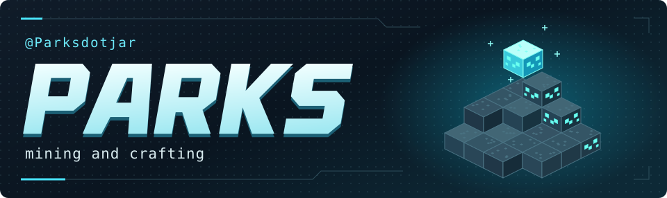

I build Minecraft tools and mods. My launcher, **Delight Client V2**, lets you keep your vanilla and Fabric setups separate, install mods from Modrinth, and tune performance with a local benchmark.

**[Eldoria Unbound](https://github.com/Parksdotjar/EldoriaUnbound)** is my custom Minecraft mod. I also publish the Windows builds of **[Delight Studio](https://github.com/Parksdotjar/Delight-Releases/releases)**.
